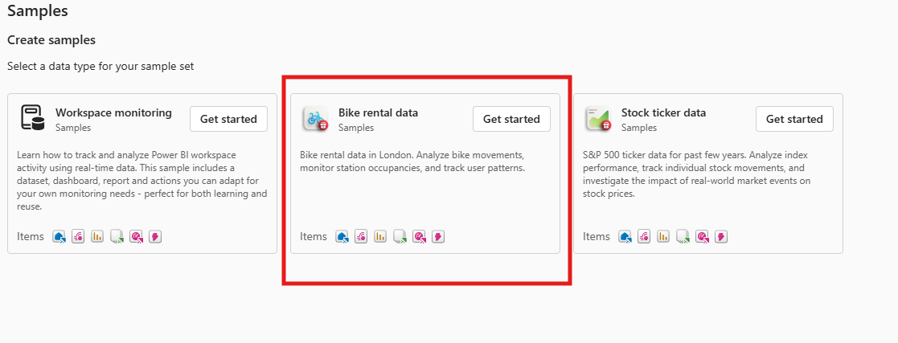
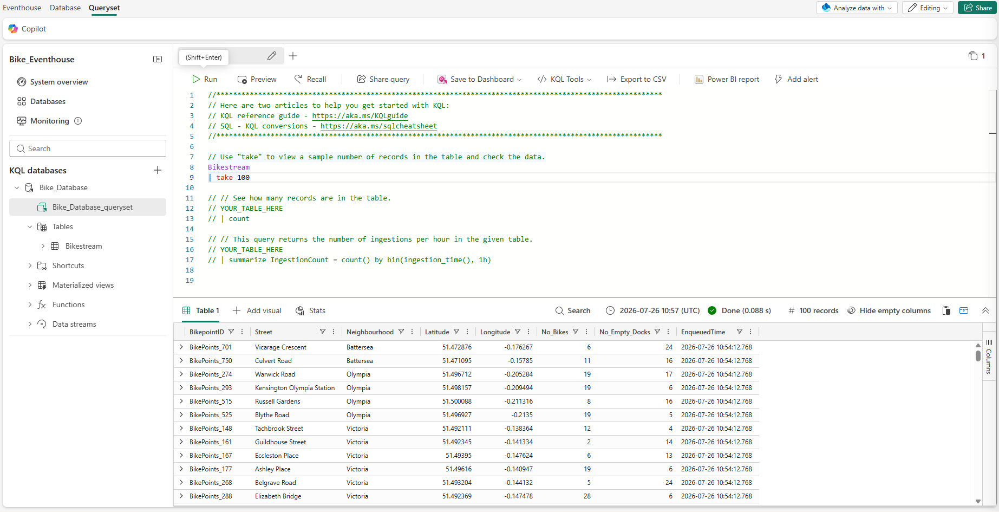
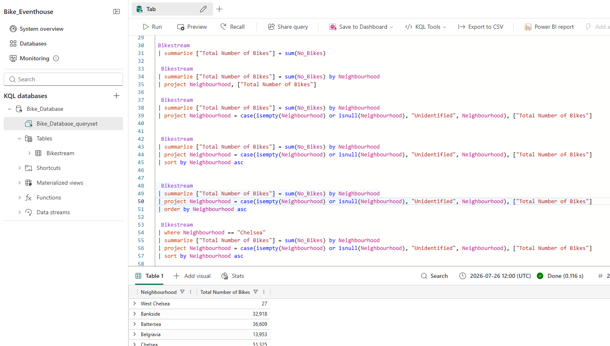
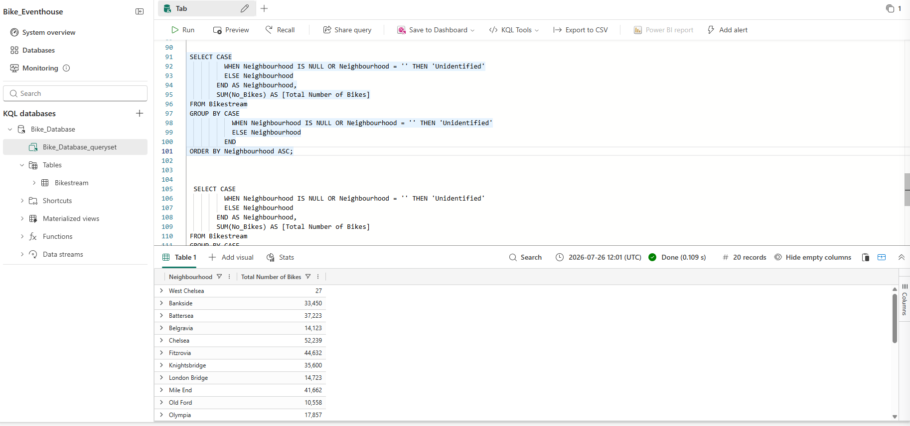
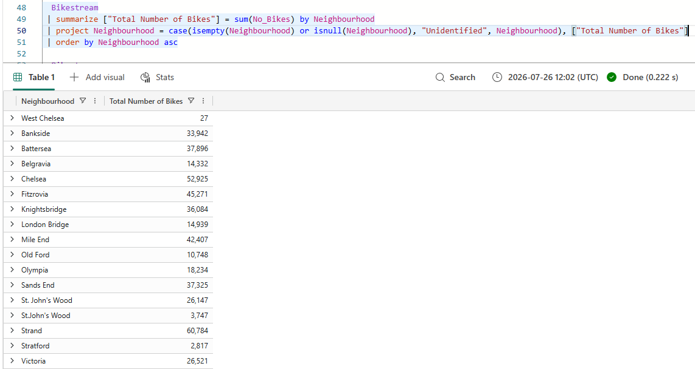

# Lab 04 – Query Data in a KQL Database Using KQL and SQL

## Repository Note

This lab was completed as part of my preparation for the **Microsoft Certified: Fabric Data Engineer Associate (DP-700)** certification. The implementation follows the official Microsoft Learn lab, while the explanations, architecture, learnings, and documentation are written in my own words.

---

# Objective

The objective of this lab was to explore Microsoft Fabric's **Real-Time Intelligence** experience by loading the **Bike Rental Data** sample into an Eventhouse and querying the data using both **Kusto Query Language (KQL)** and **Transact-SQL (T-SQL)**.

This lab demonstrates how Microsoft Fabric enables users with different skill sets to analyze the same data using either KQL or familiar SQL syntax.

---

# Business Scenario

A bike rental company continuously generates operational data such as bike availability, station locations, and rental events.

The analytics team needs a fast and scalable way to query this streaming data to identify trends, summarize information, and support operational reporting.

Microsoft Fabric's Real-Time Intelligence experience provides an Eventhouse with a KQL Database that enables high-performance analytical querying using both KQL and SQL.

---

# Solution Architecture

```text
                    Bike Rental Data Sample

                              │

                              ▼

             Microsoft Fabric Real-Time Intelligence

                              │

                              ▼

                         Eventhouse

                              │

                 ┌────────────┴────────────┐

                 ▼                         ▼

           KQL Database              SQL Endpoint

                 │                         │

                 ▼                         ▼

          Kusto Query Language      Transact-SQL

                 └────────────┬────────────┘

                              ▼

                    Analytical Query Results
```

---

# Technologies Used

- Microsoft Fabric
- Real-Time Intelligence
- Eventhouse
- KQL Database
- Queryset
- Kusto Query Language (KQL)
- Transact-SQL (T-SQL)

---

# Implementation Steps

## Step 1 – Open the Real-Time Intelligence Sample

Navigated to:

```
Workloads
    ↓
Real-Time Intelligence
    ↓
Real-Time Intelligence Samples
    ↓
Bike Rental Data
```

Selected the **Bike Rental Data** sample.

### Purpose

This sample automatically provisions a complete Real-Time Intelligence environment, allowing users to focus on querying and analyzing data without manually configuring resources.



---

## Step 2 – Explore the Eventhouse

After loading the sample, explored the generated Eventhouse which contained:

- Eventhouse
- KQL Database
- Bikestream table
- Default Queryset

### Purpose

Understand how Microsoft Fabric organizes Real-Time Intelligence resources and where the sample data is stored.



---

## Step 3 – Query Data Using Kusto Query Language (KQL)

Executed multiple KQL queries against the **Bikestream** table.

The queries included:

- Retrieving records
- Selecting specific columns
- Renaming columns
- Filtering rows
- Sorting results
- Aggregating data
- Handling null or missing values using conditional expressions

### Purpose

Learn how Kusto Query Language is used for high-performance analytical queries on operational and telemetry data.



---

## Step 4 – Query Data Using Transact-SQL (T-SQL)

Executed equivalent SQL queries through the SQL endpoint.

The queries demonstrated:

- SELECT statements
- Column aliases
- SUM()
- GROUP BY
- CASE expressions
- ORDER BY
- HAVING

### Purpose

Demonstrate how Microsoft Fabric allows SQL users to query KQL Database data using familiar Transact-SQL syntax.



---

## Step 5 – Review Query Results

Reviewed the output generated by both KQL and SQL queries and compared the analytical results.

### Purpose

Validate successful query execution and understand that the same dataset can be analyzed using different query languages depending on user requirements.



---

# Key Learnings

- Explored Microsoft Fabric's Real-Time Intelligence experience.
- Learned how Eventhouses organize real-time analytical resources.
- Queried data stored in a KQL Database using Kusto Query Language.
- Executed equivalent analytical queries using Transact-SQL.
- Performed filtering, sorting, aggregation, and conditional transformations.
- Understood how Microsoft Fabric supports both KQL and SQL for querying analytical datasets.

---

# Concepts Learned

## Real-Time Intelligence

Microsoft Fabric's Real-Time Intelligence workload enables organizations to collect, store, analyze, and visualize streaming and operational data in near real time.

---

## Eventhouse

An Eventhouse is the primary container for Real-Time Intelligence resources. It hosts one or more KQL Databases along with the objects required for real-time analytics.

---

## KQL Database

A KQL Database is optimized for analytical workloads such as telemetry, operational events, logs, and time-series data.

---

## Kusto Query Language (KQL)

KQL is Microsoft's query language designed for fast exploration and analysis of large analytical datasets.

It is commonly used in:

- Microsoft Fabric
- Azure Data Explorer
- Azure Monitor
- Microsoft Sentinel

---

## SQL Endpoint

The SQL endpoint allows users to query KQL Database data using Transact-SQL, making it easier for existing SQL users and applications to work with analytical data.

---

# Skills Demonstrated

- Microsoft Fabric
- Real-Time Intelligence
- Eventhouse
- KQL Database
- Kusto Query Language (KQL)
- SQL
- Data Exploration
- Data Analysis
- Query Development

---

# Real-World Applications

The concepts learned in this lab can be applied to:

- IoT Analytics
- Log Analytics
- Application Monitoring
- Security Analytics
- Operational Reporting
- Time-Series Data Analysis
- Streaming Data Analytics

---

# Reflection

This lab introduced me to Microsoft Fabric's Real-Time Intelligence capabilities. I learned how an Eventhouse provides a centralized environment for storing and analyzing operational data and how the same dataset can be queried using both Kusto Query Language and Transact-SQL.

The exercise also reinforced analytical query concepts such as filtering, sorting, grouping, aggregation, and conditional logic while demonstrating Microsoft's approach to supporting both KQL and traditional SQL users within the same platform.

---

# Interview Questions

## What is an Eventhouse?

An Eventhouse is a Microsoft Fabric resource used within the Real-Time Intelligence workload to organize and manage one or more KQL Databases for analytical querying.

---

## What is a KQL Database?

A KQL Database is an analytical database optimized for querying telemetry, operational, and time-series data with high performance.

---

## Why would you use KQL instead of SQL?

KQL is optimized for fast analytical exploration of large datasets, especially logs, telemetry, and streaming data, whereas SQL is traditionally used for relational data processing.

---

## Why does Microsoft Fabric provide a SQL endpoint?

The SQL endpoint enables existing SQL users and applications to query analytical data stored in a KQL Database without requiring them to learn Kusto Query Language immediately.

---

## What analytical operations were performed in this lab?

- Data retrieval
- Column projection
- Column renaming
- Filtering
- Sorting
- Aggregation
- Conditional expressions
- Grouping

---

# References

Official Microsoft Learn Lab

https://microsoftlearning.github.io/mslearn-fabric/Instructions/Labs/12-query-data-in-kql-database.html

---

# Key Takeaways

- Explored Microsoft Fabric Real-Time Intelligence.
- Loaded the Bike Rental Data sample.
- Worked with an Eventhouse and KQL Database.
- Queried analytical data using both KQL and SQL.
- Learned how Microsoft Fabric supports multiple query languages for the same analytical dataset.
- Strengthened my understanding of Real-Time Intelligence in Microsoft Fabric.